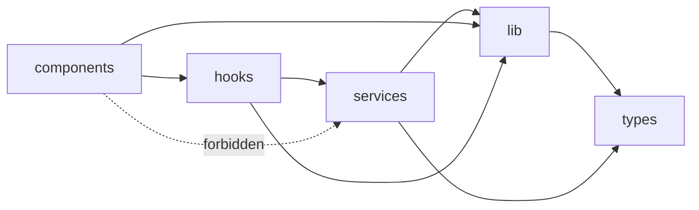
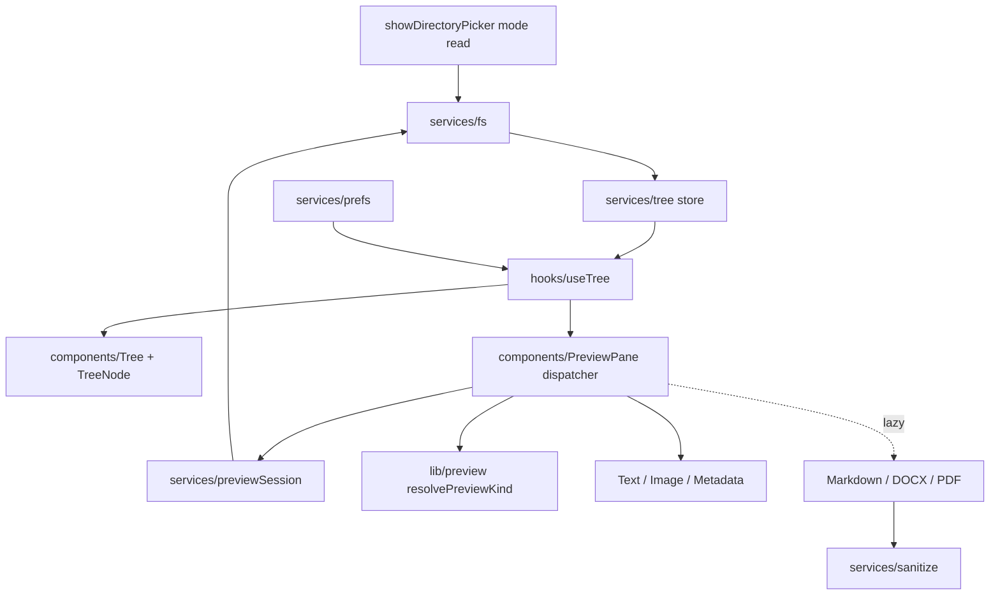

# Architecture Spine — file-browser

Stories cite these decisions by `AD-n`. IDs are stable: never renumber or reuse.

## Design Paradigm

**Functional core, imperative shell, layered.** Pure logic is the core; everything with effects (File System Access API, DOM-dependent sanitizing, `localStorage`) is the shell; React only renders.

| Layer | Path | May contain | May import |
| --- | --- | --- | --- |
| Core | `src/lib/` | Pure, deterministic functions, JSDoc `@param`/`@returns` | `types.ts` only |
| Shell | `src/services/` | File System Access calls, tree store, resource manager, sanitizer, prefs | `lib`, `types` |
| Bridge | `src/hooks/` (new) | `useSyncExternalStore` bindings to services | `lib`, `services`, `types` |
| View | `src/components/` | Rendering, event wiring, keyboard handling | `hooks`, `lib`, `types` |



Components never import `services/` directly; they go through `hooks/`. Nothing in a lower layer imports a higher one.

## Invariants & Rules

### AD-1 — One-way layering is the dependency rule `[ADOPTED]`

- **Binds:** all
- **Prevents:** DOM or File System calls leaking into `lib/`; components reaching into the FS API or the store internals.
- **Rule:** Follow the layer table and diagram above. A new module goes in the lowest layer that can hold it. `src/lib/` stays free of React, hooks, DOM and browser APIs; a function that needs any of them goes in `services/`.

### AD-2 — Brownfield foundation: ratify what exists `[ADOPTED]`

- **Binds:** all; existing `src/lib/*`, `src/services/directory.ts`, `src/types.ts`
- **Prevents:** a rewrite of working code, or two parallel conventions (old and new) in one tree.
- **Rule:** Keep, and build on:
  - the `lib/ · services/ · components/` split (now extended by `hooks/`, AD-1);
  - the pure helpers `categorizeFile`, `compareFileItems`, `formatSize`, `formatPath`, `isPdf`, which stay in `lib/`;
  - the read-only picker call (`showDirectoryPicker({ mode: 'read' })`) and Chromium feature detection (`isFolderPickerSupported`);
  - props typed explicitly in `types.ts`;
  - `FileItem` as the domain type, narrowed by AD-4.

  `compareFileItems` stays the single ordering rule (folders first, natural, case-insensitive; FR-4). Changes to this code are evolutions by new ADs, never replacements, except where AD-3 retires a named piece.

### AD-3 — Brownfield replacement: flat `FileRow` list becomes a `Tree`

- **Binds:** FR-4..FR-10, FR-8, FR-25; `FileRow.tsx`, `PdfPreview.tsx`, `App.tsx`
- **Prevents:** a hierarchical tree grafted onto a flat listbox; two competing roving-tabindex owners; mock data surviving into v1.
- **Rule:**
  - **Retire `FileRow`.** Replace it with `TreeNode`, rendered by a `Tree` container (`role="tree"`, rows `role="treeitem"`, child folders in `role="group"`, per `EXPERIENCE.md`). The `Tree` container alone owns the roving tabindex (exactly one row at `tabIndex=0`) and the keyboard map; `TreeNode` is presentational and receives focus state by prop.
  - Keep what `FileRow` got right: Enter/Space activation, a visible and named selected state, an accessible kind label, and the date/size formatting helpers.
  - **Narrow `PdfPreview`.** Keep the `<object type="application/pdf">` embed. Drop its `fetch()` and `countPdfPages` (the PRD needs no page count, and AD-12 forbids renderer `fetch`). `lib/pdf.ts` keeps `isPdf` and loses `countPdfPages`.
  - **Delete `MOCK_FILES`** and the `selected && isPdf` branch in `App.tsx`; previews go through the dispatcher (AD-9).
  - **Handoff (owner action, outside this spine's scope):** `AGENTS.md` currently mandates `role="listbox"`/`option`. Amend it to the tree semantics above before the first tree story is built; until then this AD governs.

### AD-4 — `FileItem` is pure data; its id is the normalized relative path

- **Binds:** FR-4..FR-7, FR-20; `src/types.ts`
- **Prevents:** handles or blob URLs on the domain type; ids that change on Refresh (today's `crypto.randomUUID()`).
- **Rule:**
  - `FileItem` stays serializable: `id`, `name`, `path`, `isDirectory`, plus metadata filled on demand (`size`, `updatedAt`, `category`). Remove `url` and `children`.
  - `id` equals the entry's path relative to the Workspace Folder: `/`-separated, no leading or trailing slash, root = `''`. `path` equals `id` prefixed with `/` for display. The same entry always produces the same id across reads.
  - Tree structure (parent/children) lives in the store (AD-5), not on the item.

### AD-5 — A single runtime tree store owns handles and tree state

- **Binds:** FR-1, FR-5..FR-7, FR-9, FR-10, FR-20, FR-21; `src/services/tree`, `src/hooks/useTree`
- **Prevents:** handles or expansion state scattered in components; two writers racing on the same entry.
- **Rule:**
  - `services/tree` is the **only** holder of `FileSystemDirectoryHandle`/`FileSystemFileHandle` references, the children cache (`id → child ids`), the expansion set, the selection id and the per-entry "unavailable" marks. All keyed by AD-4 ids.
  - It is the **only writer**: components call intent functions (`openWorkspace`, `toggle`, `select`, `refresh`) and never mutate state.
  - React reads it through `hooks/` using `useSyncExternalStore` with immutable snapshots.
  - Selection is a single id (FR-7); selecting a folder toggles it and leaves the file selection untouched.
  - Replacing the Workspace Folder discards all of it (FR-1, FR-6).

### AD-6 — Listing is lazy, one level, names and kinds only

- **Binds:** FR-4, FR-5, FR-9, FR-10, NFR-2, NFR-4
- **Prevents:** `getFile()` on every entry at list time (today's `toFileItem`); recursive reads; re-reading disk when only a view setting changed.
- **Rule:**
  - Opening the workspace and expanding a folder each read exactly one level through `handle.values()`, recording `name` and `kind` only.
  - `size`, `updatedAt` and type come from `getFile()`, and only for the Selection when it is selected or refreshed.
  - A folder is read at most once until Refresh (cached, FR-5). Dotfile visibility is a **view filter** over the cached children (FR-9); toggling never re-reads.
  - Sorting uses `compareFileItems` over the cached level (AD-2).
  - A read that throws marks that entry "unavailable" and leaves the rest of the tree usable (FR-10).

### AD-7 — Refresh reconciles by id

- **Binds:** FR-20, FR-21
- **Prevents:** Refresh rebuilding the tree and losing expansion and selection; stale previews.
- **Rule:** `refresh()` re-reads the root and every currently expanded folder, replaces each cached level, and keeps the expansion set and Selection for every id that still exists. If the Selection id is gone or unreadable, clear it and surface the FR-21 message. If it survives, reload its metadata and Preview through AD-10. Collapsed, never-expanded folders are not read.

### AD-8 — Preview kind is resolved by one pure function

- **Binds:** FR-12..FR-18; `src/lib/preview.ts`
- **Prevents:** per-renderer or per-component type detection that disagrees about the same file.
- **Rule:** `resolvePreviewKind(name, mime) → PreviewKind` in `lib/`, where `PreviewKind` is `text | markdown | pdf | docx | image | metadata`. It uses the extension, the exact-name text list from `EXPERIENCE.md` and the device-reported `File.type`; **no content sniffing** (FR-17). Zero-byte files and `.doc` resolve to `metadata`. `isPdf` is expressed through it.

### AD-9 — A dispatcher maps kind to a lazily loaded renderer

- **Binds:** FR-11..FR-19, NFR-1, NFR-3
- **Prevents:** heavy renderers in the initial bundle; renderers that depend on tree internals.
- **Rule:**
  - One `PreviewPane` dispatcher selects a renderer by `PreviewKind`. The `markdown`, `docx` and `pdf` renderers load via `React.lazy` or dynamic `import()`; `text`, `image` and `metadata` may be static if they stay small (AD-15).
  - Renderer contract: input is a `PreviewSource` (`{ file: File, signal: AbortSignal }` plus resolved metadata), output is DOM. Renderers never receive a handle and never import `services/tree`.
  - A renderer that throws, or rejects, renders the Metadata Card with the FR-18 explanation. The Preview Pane never goes blank.

### AD-10 — One selection-scoped resource manager owns every per-preview resource

- **Binds:** FR-7, FR-11..FR-18, FR-20; `src/services/previewSession`
- **Prevents:** leaked `blob:` URLs, stale async results painting over a newer selection, and eager URL creation (today `createObjectURL` for every PDF at list time).
- **Rule:**
  - Each selection (and each Refresh of the selection) opens a **session** that owns one `AbortController`, the `File` read and every object URL created for that preview.
  - Starting a new session first aborts the previous one, revokes its URLs and ensures its late results are discarded (**latest selection wins**).
  - Only `previewSession` calls `URL.createObjectURL`/`revokeObjectURL`. This replaces `App`'s `openedItems` ref and `revokeItemUrls`.

### AD-11 — Previewed content is inert; one sanitizing chokepoint

- **Binds:** FR-13, FR-14, FR-16, NFR-5, NFR-6, SM-C1
- **Prevents:** a renderer that bypasses sanitizing; script, remote fetches, or navigation from previewed files.
- **Rule:**
  - Every renderer that produces HTML (Markdown, DOCX) passes its output through `services/sanitize` before it reaches the DOM. It is an allowlist that removes scripts, event-handler and `style` attributes, and any `src`/`href` pointing off the page; remote images become the "Remote image blocked" placeholder; `#anchor` links stay in-page; other links become plain text (`EXPERIENCE.md`).
  - Images render only as `` created by AD-10. SVG is never inlined. `<iframe srcdoc>` is not used for previews (theme inheritance and keyboard reach).
  - Sanitizing runs in `services/` because it needs the DOM (AD-1). Weakening it for speed is prohibited (SM-C1).

### AD-12 — A meta CSP is the second wall, verified rather than assumed

- **Binds:** NFR-5, NFR-6, SM-3; `index.html`
- **Prevents:** treating CSP as the only defense; a CSP that silently breaks the PDF embed or inline styles.
- **Rule:**
  - `index.html` carries a meta CSP of this shape: `default-src 'self'; connect-src 'none'; img-src 'self' blob: data:; object-src blob:; style-src 'self'; script-src 'self'; base-uri 'none'; form-action 'none'`. Exact values are finalized by the story that adds it and tested against the production build.
  - Consequences that bind other code: no renderer may call `fetch()` (even for `blob:`, which `connect-src 'none'` blocks); components use CSS classes and custom properties, **not** inline `style` attributes (`style-src 'self'`); the sanitizer strips `style` attributes from previewed HTML.
  - **It is not a guarantee.** A meta CSP cannot set `frame-ancestors` and does not stop top-level navigation, so AD-11 remains the first wall. The zero-outbound-requests claim is proven by the SM-3 hostile-Markdown test run against `vite build` + `vite preview`; the dev server uses a relaxed variant and is not evidence.

### AD-13 — Read-only is enforced at one module boundary

- **Binds:** FR-2, FR-3, NFR-7
- **Prevents:** a write, rename or delete path appearing anywhere in the app.
- **Rule:** `services/fs` is the only module that references `FileSystem*Handle`. Its whitelist: `showDirectoryPicker({ mode: 'read' })`, `values()`, `getDirectoryHandle()`, `getFileHandle()`, `getFile()`, and `queryPermission`/`requestPermission` with `{ mode: 'read' }`. `createWritable`, `removeEntry`, `move`, `readwrite` and `FileSystemWritableFileStream` are forbidden. A grep gate in the lint step fails the build on any forbidden identifier.

### AD-14 — Only two preferences persist; themes are CSS custom-property sets

- **Binds:** FR-9, FR-22, FR-23, NFR-7
- **Prevents:** file contents or paths written to storage; theme logic in component code.
- **Rule:** `services/prefs` persists exactly `theme` and `showDotfiles` in `localStorage`, every access in `try/catch`, rendering correctly when storage is unavailable. A theme is a set of CSS custom properties selected by `data-theme` on the document element; components consume tokens only (palette values live in `DESIGN.md`). Workspace Folder, handles, paths and divider width are not persisted.

### AD-15 — The initial bundle has a hard budget

- **Binds:** NFR-1, SM-2, SM-C2
- **Prevents:** a heavy dependency creeping into the first load.
- **Rule:** Initial JS stays under 150 KB gzipped. Any dependency over about 15 KB gzipped is imported only through a dynamic `import()` reachable from a renderer. The budget is checked against `vite build` output in each story that adds a dependency. Bundle size is never recovered by dropping keyboard or screen-reader support (SM-C2).

## Consistency Conventions

| Concern | Convention |
| --- | --- |
| Naming | Components `PascalCase.tsx` in `components/`; hooks `useThing.ts` in `hooks/`; services and lib `camelCase.ts`; one exported renderer per `components/preview/<Kind>Preview.tsx` |
| Data & formats | Ids per AD-4; dates as `Date` in memory, formatted at the view; all sizes in bytes via `formatSize`; UX strings come from `EXPERIENCE.md` Voice and Tone, never raw error text |
| State & cross-cutting | Tree and selection state per AD-5; resources per AD-10; no `useState` copies of store data; errors become typed outcomes (`unavailable`, `renderFailed`), not thrown into the UI |
| Types | Shared and prop types in `src/types.ts` (AGENTS.md); `PreviewKind`, `PreviewSource` exported from there |
| Verification | `npm run build` and `npm run lint` pass before any commit (AGENTS.md); `lib/` functions get unit tests in Vitest `[ADOPTED]`, added by the first story that needs it |

## Stack

| Name | Version |
| --- | --- |
| React / React DOM | ^19.2.8 |
| TypeScript | ~6.0.2 |
| Vite / @vitejs/plugin-react | ^8.3.0 / ^6.1.1 |
| oxlint | ^1.81.0 |
| File System Access API | Chromium (Chrome, Edge) |

Versions are taken from `package.json` in the repo. Markdown, DOCX and sanitizer libraries are deliberately unpinned; see Deferred.

## Structural Seed



```text
src/
  types.ts            # FileItem, PreviewKind, PreviewSource, prop types
  lib/                # pure: files, format, preview (resolver), pdf (isPdf)
  services/           # fs, tree (store), previewSession, sanitize, prefs
  hooks/              # useTree, usePrefs
  components/         # Tree, TreeNode, Toolbar, PreviewPane, preview/<Kind>Preview
index.html            # meta CSP (AD-12)
```

## Capability → Architecture Map

| Capability / Area | Lives in | Governed by |
| --- | --- | --- |
| Choose folder, read-only (FR-1..FR-3) | `services/fs`, `services/tree` | AD-5, AD-13 |
| Lazy tree, select, unreadable (FR-4..FR-7, FR-10) | `services/tree`, `components/Tree` | AD-4, AD-5, AD-6 |
| Tree keyboard and a11y (FR-8) | `components/Tree` | AD-3 |
| Dotfile toggle (FR-9) | `services/tree` view filter, `services/prefs` | AD-6, AD-14 |
| Previews and fallback (FR-11..FR-19) | `components/PreviewPane`, `lib/preview` | AD-8, AD-9, AD-10, AD-11 |
| Refresh (FR-20, FR-21) | `services/tree` | AD-7, AD-10 |
| Themes (FR-22, FR-23) | CSS custom properties, `services/prefs` | AD-14 |
| Two-pane layout, no mocks (FR-24, FR-25) | `App.tsx`, `components/` | AD-3 |
| Privacy and inertness (NFR-5, NFR-6) | `services/sanitize`, `index.html` | AD-11, AD-12 |
| Performance and bundle (NFR-1..NFR-4) | `services/tree`, build | AD-6, AD-9, AD-15 |

## Deferred

| Decision | Why it can wait | Revisit when |
| --- | --- | --- |
| Markdown parser, DOCX converter, sanitizer library and versions | Capability is fixed by AD-9 and AD-11; current versions need web verification and a bundle measurement | The story adding each renderer |
| Exact CSP string | Depends on measured behavior of the PDF embed and the production build | The story that adds the meta tag |
| Virtualized tree rendering | Single folders over about 2,000 entries are out of v1 scope (NFR-4) | A folder over 2,000 entries is a target |
| Live change detection (v2) | Out of v1; the store (AD-5) and Refresh (AD-7) are the seam | v2 planning |
| Remembering the last Workspace Folder | Needs persisted handles and re-granted access; conflicts with the current preference list (AD-14) | Daily use shows re-pick friction |
| Pane divider implementation and persistence | UX-level, no cross-unit divergence | The layout story |
| Unit test runner | `lib/` is pure and easy to test; the tool choice does not bind other units | The first story that adds tests |
